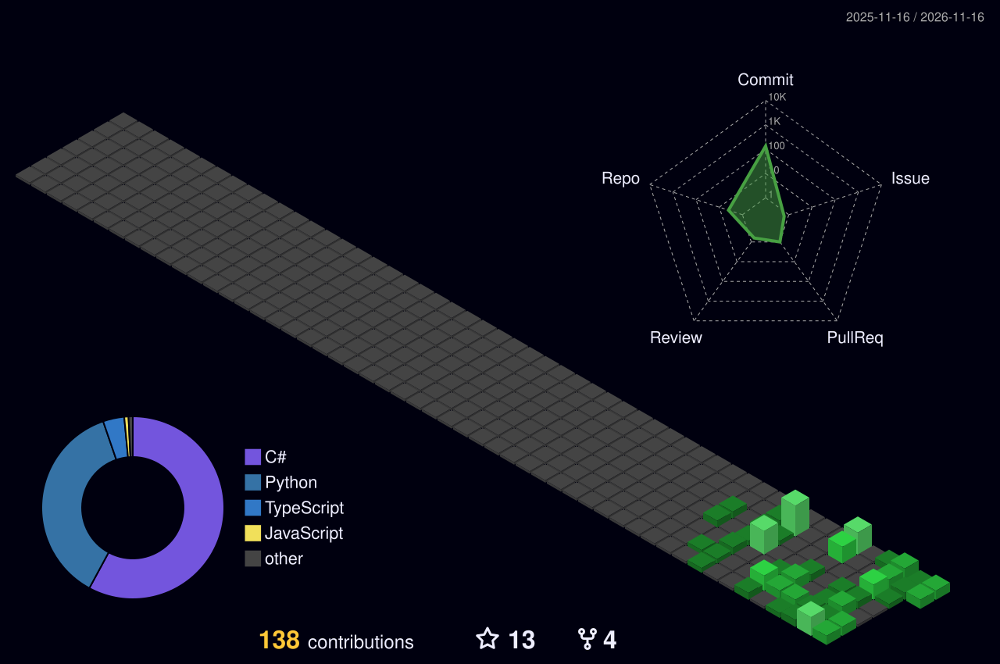

  
  
   
   
   
   
  
  

    

      
    

    

      
    

    

      
    

  

   
  
  

    
  

  
   

  <table>
    <thead>
      <tr>
        <th colspan="2">
          

            
          

        </th>
      </tr>
    </thead>
  <tbody>
    <tr>
      <td>
        

            
          &nbsp
            <strong  align="center">
              StackOverflow
            </strong>
        

      </td>
      <td>
        

          
        

      </td>
    </tr>
    <tr>
      <td>
        

          <strong>
            Programming Languages
          </strong>
        

      </td>
      <td>
        

          
        

      </td>
    </tr>
    <tr>
      <td>
        

          <strong>
            Frameworks & Databases
          </strong>
        

      </td>
      <td>
        

          
        

      </td>
    </tr>
    <tr>
      <td>
        

          <strong>
            Operating Systems, Cloud, & IoT
          </strong>
        

      </td>
      <td>
        

          
        

      </td>
    </tr>
    <tr>
      <td colspan="2">
        

            
        

      </td>
    </tr>
  </tbody>
</table>

 
 

# Top projects

 

# 🚀 Projects Portfolio — Ranked by Vibe-Coding Difficulty

*Projects are ordered from hardest to easiest to reproduce using AI-assisted, prompt-driven development.*

**Metrics:**
- **Vibe-coding difficulty:** Engineering complexity, rated from 1 to 10.
- **Vibe-coding probability:** Estimated probability of an AI coding agent independently producing a working implementation of comparable scope.

---

## 1. 🎙️ Pytacte — Speech-to-Text Platform

| Metric | Assessment |
|---|---:|
| Vibe-coding difficulty | **9.5/10** |
| Vibe-coding probability | **10–20%** |

Pytacte is a speech-to-text project focused on building a client-server transcription architecture. It uses Python for speech processing and WebSockets for communication between clients and the transcription server.

**Key architectural features:**
- 🎙️ Microphone audio streaming over WebSockets
- 👥 Independent client sessions with isolated audio buffers and VAD state
- 🔊 Voice Activity Detection (VAD) and audio pre-buffering
- ⚙️ Shared transcription model infrastructure for processing multiple clients
- 🧠 Exploration of lightweight, locally hosted speech recognition models
- 🔧 Configurable deployment architecture supporting monolithic and microservice approaches

**Repository:** [Pytacte GitHub](https://github.com/CSharpTeoMan911/Pytacte)

---

## 2. 🧠🤖 Eva — AI Assistant

| Metric | Assessment |
|---|---:|
| Vibe-coding difficulty | **9/10** |
| Vibe-coding probability | **15–25%** |

Eva is an open-source AI assistant that combines speech recognition and natural language understanding to interpret and execute voice commands.

**Key features:**
- 🗣️ Speech recognition and voice-command processing
- 📲 Launch and close applications
- ⚙️ Interact with operating system settings
- 📷 Capture screenshots
- 🤖 Submit queries to ChatGPT
- ⏰ Set timers
- 🔍 Search the web and web applications

**Links:**
- **Repository:** [Eva GitHub](https://github.com/CSharpTeoMan911/Eva)
- **Wiki:** [Eva Wiki](https://github.com/CSharpTeoMan911/Eva/wiki)
- **SourceForge:** [Eva AI](https://sourceforge.net/projects/eva-ai/)

---

## 3. 📁 ThetaDrive

| Metric | Assessment |
|---|---:|
| Vibe-coding difficulty | **8.5/10** |
| Vibe-coding probability | **20–30%** |

ThetaDrive is an open-source alternative to Google Drive, combining file management with security-focused features.

**Key features:**
- 🔐 Two-step authentication
- 🔒 AES-256 encrypted file storage
- 🛡️ SHA-512 salted password hashing
- 🔐 TLS-secured communication
- 📤 File uploads and downloads
- 📁 Directory creation and management
- 🔀 File and directory relocation and renaming

**Links:**
- **Repository:** [ThetaDrive GitHub](https://github.com/CSharpTeoMan911/ThetaFTP)
- **Wiki:** [ThetaDrive Wiki](https://github.com/CSharpTeoMan911/ThetaFTP/wiki)
- **Live Website:** [theta-drive.org](https://theta-drive.org)

---

## 4. 🍓📡 BerrySonar

| Metric | Assessment |
|---|---:|
| Vibe-coding difficulty | **8/10** |
| Vibe-coding probability | **25–35%** |

BerrySonar is a Linux-based C# application for Raspberry Pi that implements a DIY LiDAR-like scanning system. It rotates an HC-SR04 ultrasonic sensor using a 28BYJ-48 stepper motor to scan a 180° arc, measuring object distances and streaming scan metadata to Firebase Realtime Database.

**Key features:**
- 🌀 180° object scanning using a rotating ultrasonic sensor
- 🔄 Stepper motor control using a 28BYJ-48 and ULN2003A driver
- ☁️ Firebase integration with role-based access
- 💻 C# and .NET 8 support on Raspberry Pi-compatible Linux distributions

**Repository:** [BerrySonar GitHub](https://github.com/CSharpTeoMan911/BerrySonar)

---

## 5. 🚨📏 ProximityAlert

| Metric | Assessment |
|---|---:|
| Vibe-coding difficulty | **7/10** |
| Vibe-coding probability | **35–50%** |

ProximityAlert is a real-time proximity detection system built around a Raspberry Pi 4 running Ubuntu Server 24.04 LTS. It uses ultrasonic sensors and a C# service to detect objects within a 30 cm radius.

The system supports headless operation and can optionally launch a GNOME desktop environment when required. Detection events are logged and stored in Firebase Realtime Database.

**Key features:**
- 📏 Ultrasonic object detection within a 30 cm range
- 🔧 Headless Ubuntu Server with optional GUI support
- ☁️ Firebase integration for real-time cloud alerts
- 🛠️ Systemd service-based architecture
- 📡 Remote access and SSH management

**Repository:** [ProximityAlert GitHub](https://github.com/CSharpTeoMan911/Proximity_Alert)

---

## 6. 🌐📊 BerrySonar View

| Metric | Assessment |
|---|---:|
| Vibe-coding difficulty | **6/10** |
| Vibe-coding probability | **55–70%** |

BerrySonar View is a React-based web dashboard that subscribes to BerrySonar's Firebase data feed. It uses trigonometry to convert polar coordinates into canvas coordinates and renders live scan data as a radar-style visualization.

**Key features:**
- 🔗 Real-time Firebase Realtime Database integration
- 📡 Dynamic 180° radar sweep rendered using HTML5 Canvas
- 📐 Polar-to-Cartesian coordinate conversion
- 🎨 Configurable sweep speed, point colours and canvas dimensions
- 💨 Smooth, flicker-free rendering using React hooks and `requestAnimationFrame`

**Repository:** [BerrySonar View GitHub](https://github.com/CSharpTeoMan911/berry-sonar-view)

---

## 7. 📁 Sharpfile — Cross-Platform Terminal File Manager

| Metric | Assessment |
|---|---:|
| Vibe-coding difficulty | **5.5/10** |
| Vibe-coding probability | **60–75%** |

Sharpfile is a native terminal-based file manager written in C#, designed for both Linux and Windows without requiring external dependencies.

Inspired by modern frontend frameworks such as React, Sharpfile brings dynamic, responsive layouts and interactive navigation to the terminal.

**Key features:**
- 📂 File operations: open, copy, move, rename and delete
- 🧭 Directory navigation and path jumping
- ⚙️ No external library dependencies
- 🐧 Linux and 🪟 Windows support
- 🚀 Lightweight, cross-platform native performance

**Links:**
- **Repository:** [Sharpfile GitHub](https://github.com/CSharpTeoMan911/Sharpfile)
- **Releases:** [Sharpfile Releases](https://github.com/CSharpTeoMan911/Sharpfile/releases)

---

*Note: These probabilities are subjective estimates, not empirical measurements. They refer to reproducing comparable working functionality, rather than generating a prototype or UI.*

